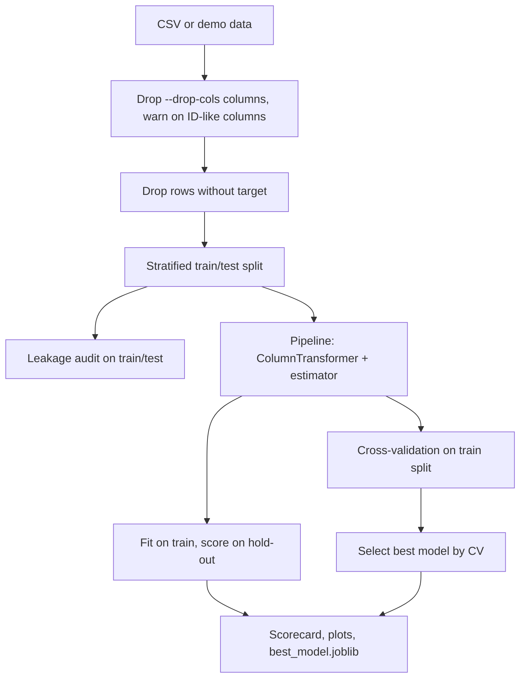

# Architecture

## Modules (`src/dataprep_baseline/`)

| Module             | Responsibility                                          |
|--------------------|---------------------------------------------------------|
| `config.py`        | Single source of truth for settings (env vars, validation). |
| `data.py`          | CSV loading, column dropping, ID-like column warnings, synthetic demo data. |
| `preprocessing.py` | Numeric and categorical `ColumnTransformer` branches.   |
| `models.py`        | Baseline estimators and the combined Pipeline factory.  |
| `evaluate.py`      | In-pipeline CV and hold-out metrics.                    |
| `leakage.py`       | Runtime leakage audit.                                  |
| `pipeline.py`      | Orchestration and artifact export.                      |
| `plots.py`         | Confusion matrix, ROC and regression plots.             |
| `cli.py`           | Command line interface.                                 |

## Invariants

- No transformer is fitted outside a `Pipeline`, and none is fitted on hold-out data.
- Cross-validation receives the complete Pipeline, so each fold refits preprocessing on its own training portion.
- Model selection uses CV scores on the training split, never the hold-out set.
- Column dropping is a fixed, data-independent choice made by the user, so it cannot leak information between splits.
- All randomness flows from one seed.
