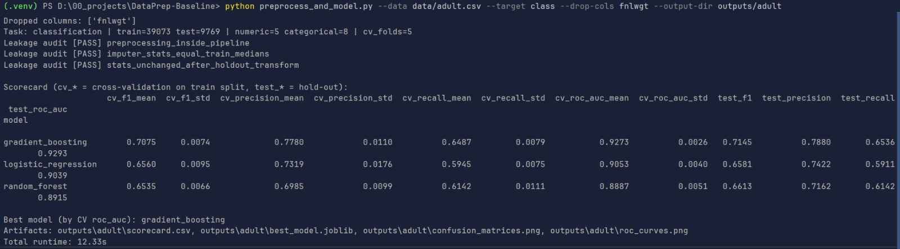
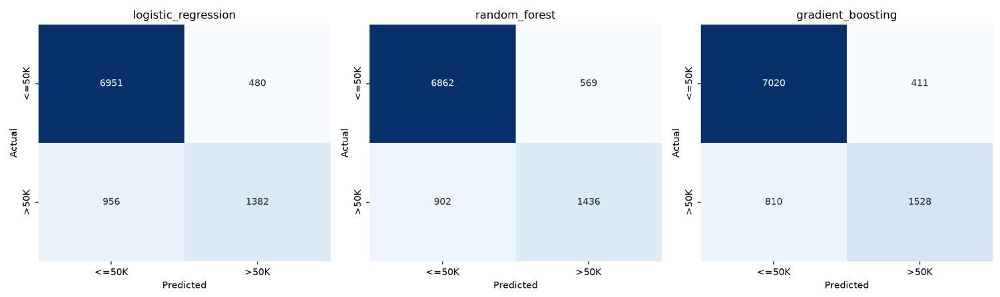
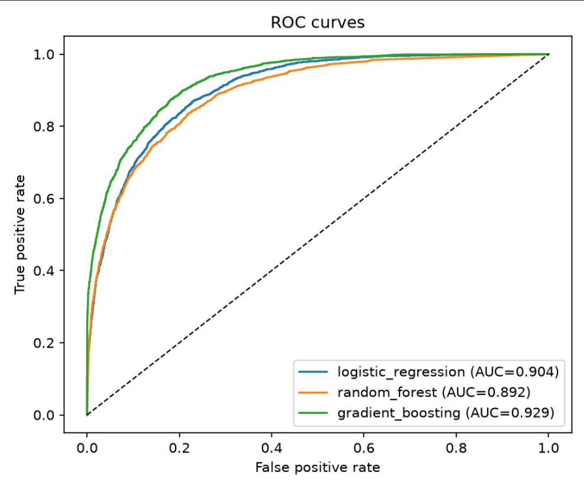
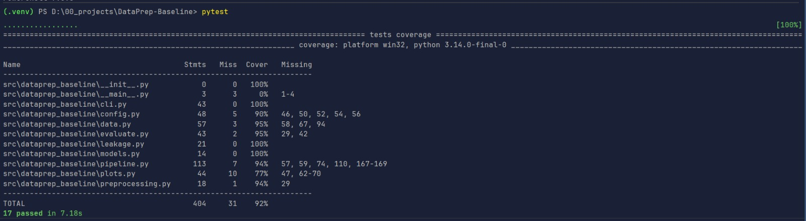
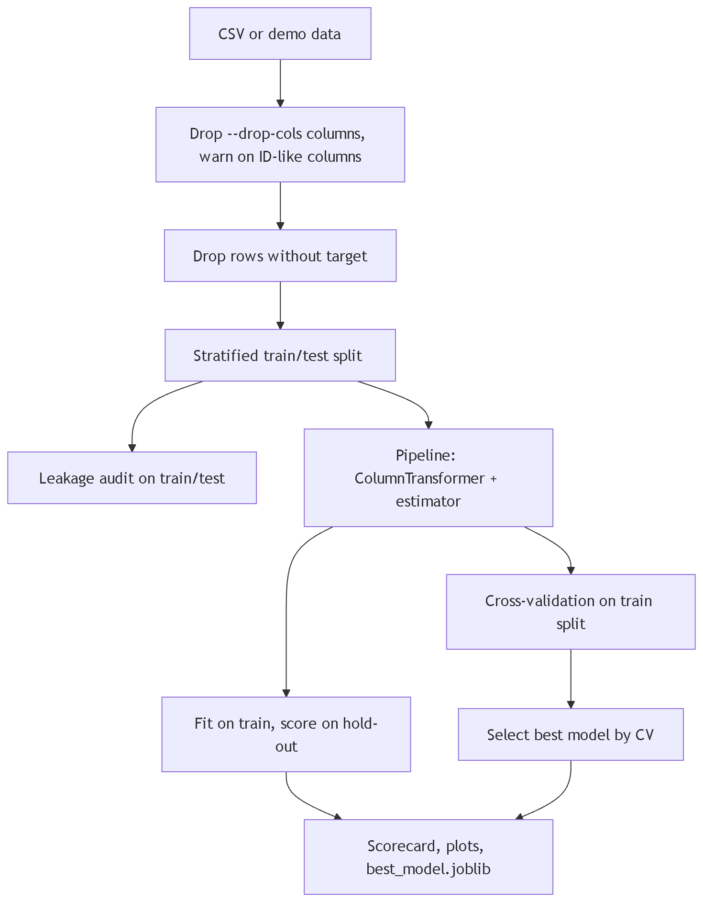

# DataPrep-Baseline v0.2.0

**Release date:** 2026-10-11

## Executive summary

DataPrep-Baseline is a leak-free preprocessing and baseline modeling engine built on scikit-learn `Pipeline` and
`ColumnTransformer`. This release makes it usable on real datasets: you can bring any CSV, exclude ID or junk columns,
and get a scorecard, plots and a single serialized model. It is verified on the Adult Census Income dataset (48,842
rows) with a clean run in about 12 seconds.

## Highlights

- **Bring your own dataset:** `--data` and `--target` work with any CSV. A documented example dataset (Adult) is in
  [docs/data/README.md](../data/README.md).
- **`--drop-cols` flag** (and `DATAPREP_DROP_COLS`): exclude ID, leaky or junk feature columns.
- **ID-like column warning:** non-float columns with almost one unique value per row are flagged before they explode
  one-hot encoding.
- **Clear input errors:** a missing file, missing target or invalid setting prints a clear message and exits with
  code 2.
- **Default scaler is now `standard`:** on Adult, `robust` scaling left zero-inflated columns unscaled and logistic
  regression failed to converge. `standard` converges cleanly with the same scores. `--scaler robust` remains
  available. See [Usage](../usage.md#choosing-a-scaler).
- **Configurable logistic regression iteration limit:** `DATAPREP_LR_MAX_ITER` (default 1000).
- **Built-in leakage audit** still runs before any score is reported (three checks, all passing).

## Verified outcome

Adult Census Income, 39,073 train rows and 9,769 hold-out rows, 5-fold cross-validation on the train split:

| Model               | CV ROC-AUC | Hold-out ROC-AUC | Hold-out F1 |
|---------------------|-----------:|-----------------:|------------:|
| gradient_boosting   |     0.9273 |           0.9293 |      0.7145 |
| logistic_regression |     0.9053 |           0.9039 |      0.6581 |
| random_forest       |     0.8887 |           0.8915 |      0.6613 |

Gradient boosting was selected by cross-validation on the training split. CV and hold-out scores agree closely, and all
three leakage audit checks passed. Full details are in [results](../results/README.md).

### Terminal run

```text
python preprocess_and_model.py --data data/adult.csv --target class --drop-cols fnlwgt --output-dir outputs/adult
Task: classification | train=39073 test=9769 | numeric=5 categorical=8 | cv_folds=5
Leakage audit [PASS] preprocessing_inside_pipeline
Leakage audit [PASS] imputer_stats_equal_train_medians
Leakage audit [PASS] stats_unchanged_after_holdout_transform
Best model (by CV roc_auc): gradient_boosting
Total runtime: 12.33s
```







### Test suite

17 tests passed with 92% coverage.



### Architecture



See [Architecture](../architecture.md) for module responsibilities and invariants.

## Breaking changes

None. This is the first tagged release, so the scaler default change affects no existing users.

## Migration guide

Not applicable. To keep the previous scaling behavior, pass `--scaler robust` or set `DATAPREP_SCALER=robust`.

## Changelog

See the automated changelog: [CHANGELOG.md](https://github.com/Bibek-Dhakal/DataPrep-Baseline/blob/main/CHANGELOG.md).

## Contributors

- Bibek Dhakal
